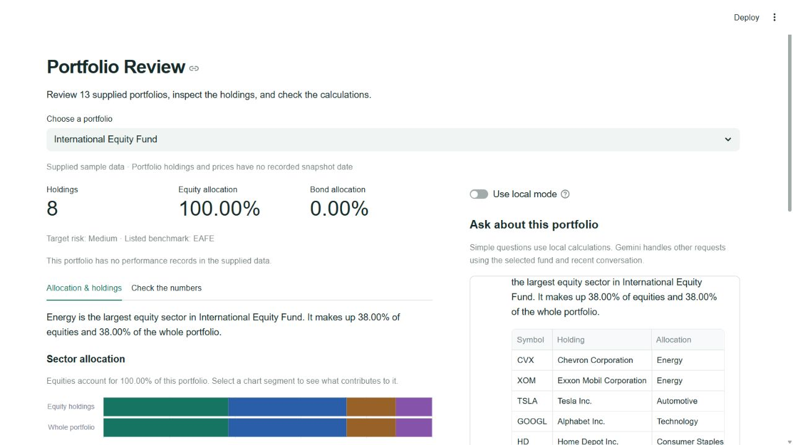
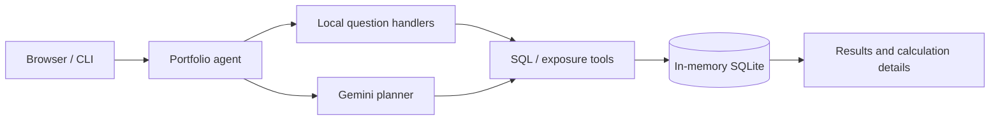

# Portfolio Review

**PL Capital · AI Engineering Take-Home**

Ask questions about investment portfolios in plain English, inspect the holdings behind each answer, and compare how allocation figures were calculated.

Python · Gemini · SQLite · Streamlit · Altair

[Quick start](#quick-start) · [Try it](#try-it) · [Check the numbers](#check-the-numbers) · [Evaluation](#evaluation) · [How it works](#how-it-works)



## Assignment coverage

| Required deliverable | Implementation |
| --- | --- |
| Command-line portfolio agent | [cli.py](cli.py) uses the same agent as the browser |
| Natural-language SQL tool | Gemini generates SQL for execution through a read-only SQLite allowlist |
| Equity sector exposure calculator | Groups recorded stock weights by sector, excluding bonds from equity exposure |
| Ground-truth evaluator | [evaluate.py](evaluate.py) runs the 10 supplied questions in Gemini-only mode |
| Run documentation and error handling | Setup below, inline browser errors, bounded query execution, and one retry for eligible provider errors |

The browser adds allocation charts, sortable holdings, conversational context, and calculation evidence for all **13 supplied portfolios**.

## Quick start

Requires **Python 3.11+**. Keep the supplied `Exercise_PL_AI_Engineer.zip` in the repository root.

```bash
git clone https://github.com/vedanshmehrotra/PL-Capital-Assignment.git
cd PL-Capital-Assignment
python -m venv .venv
```

<details open>
<summary><strong>Windows / PowerShell</strong></summary>

```powershell
.\.venv\Scripts\python.exe -m pip install -r requirements.txt
Copy-Item .env.example .env
```

Paste your Google AI Studio key into the local `.env` file, then start the app.

```powershell
.\.venv\Scripts\python.exe -m streamlit run app.py
```

</details>

<details>
<summary><strong>macOS / Linux</strong></summary>

```bash
.venv/bin/python -m pip install -r requirements.txt
cp .env.example .env
# Add your Gemini key to .env, then run:
.venv/bin/python -m streamlit run app.py
```

</details>

Open the URL printed by Streamlit. The direct dependencies are pinned to the versions used for validation.

```dotenv
GEMINI_API_KEY=your_key_here
# Optional model override:
# GEMINI_MODEL=gemini-3.5-flash-lite
```

The browser, CLI, and evaluator read `.env`. Environment variables take precedence. The actual `.env` stays local and is excluded by `.gitignore`.

Without a key, local mode supports reviews, holdings, counts, and sector exposures. General natural-language queries and the live evaluator require Gemini. The default model is `gemini-3.5-flash-lite`.

## Try it

Select a fund, then type a question. The portfolio and its holdings remain visible beside the conversation.

| Question | What it checks |
| --- | --- |
| “How are the holdings?” | Uses the selected fund and shows its recorded holdings |
| “Pick any random one.” | Refers back to the holdings in the previous reply |
| “What are the sector exposures for this portfolio?” | Shows equity-only and whole-portfolio percentages with contributing positions |
| “Which portfolios hold both Apple and Microsoft? Show their combined recorded weight, highest first.” | Uses Gemini to generate a cross-portfolio query |
| “Which portfolios have no performance records? Return their names.” | Handles missing records across the supplied dataset |

**An example you can verify.** In the Balanced Portfolio, Apple is **12%** and Microsoft is **10%** of the recorded whole-portfolio weight. Their combined weight is **22%**.

Every reply shows whether it used **local calculations** or **Gemini routing**, along with model-call and token information when available. Simple local questions make zero Gemini calls.

## Check the numbers

This custom review feature helps explain why two portfolio reports might show different allocations.

It compares the supplied holding weights with weights rebuilt from **quantity × supplied current price**, then shows the positions behind the difference.

**Balanced Portfolio · Technology allocation**

| Calculation basis | Share of the whole portfolio |
| --- | ---: |
| Recorded holding weights | **22.00%** |
| Rebuilt from supplied quantities and prices | **36.22%** |
| Difference | **+14.22 percentage points** |

Choose an allocation to inspect each holding's contribution. Download a review note containing the comparison, calculation method, and source files.

The original equity exposure calculator continues to use recorded weights. The comparison separately highlights missing weights, requires complete position inputs in a single currency, and follows the exercise's quantity × price convention for bonds. Holding and quote snapshot dates are absent, so differences need a source check before either basis is used in a report.

## Evaluation

**Observed validation · November 6, 2026**

| Check | Result |
| --- | --- |
| Supplied questions through Gemini only | **10 / 10 passed** |
| Local regression suite | **16 / 16 passed** |
| Portfolio views and local chat context | **13 / 13 funds passed** |
| Live Gemini stock/bond holding counts | **13 / 13 selected funds passed** |
| Fresh installation and extracted submission package | Dependencies, local CLI, SDK imports, and browser workflow passed |

Additional checks covered the Apple/Microsoft query, all nine funds without performance records, contextual follow-ups, bond-only funds, the 2% unrepresented-weight case, and inline timeout handling.

These are point-in-time results. Earlier live runs encountered Gemini HTTP 503/504 errors. Eligible server errors are retried once, and provider failures are reported separately as **UNAVAILABLE**.

### Run the CLI and checks

```powershell
# Local example, with no API request
.\.venv\Scripts\python.exe cli.py --demo "How many portfolios do we have in total?"

# Live question; omit the question to enter the interactive CLI
.\.venv\Scripts\python.exe cli.py "What are the names of all active portfolios?"

# Live assignment evaluator
.\.venv\Scripts\python.exe evaluate.py

# Local regression tests
.\.venv\Scripts\python.exe -m unittest -v test_portfolio
```

On macOS/Linux, use `.venv/bin/python` in place of `.\.venv\Scripts\python.exe`.

The evaluator **disables local-first routing**. It executes reference SQL independently and derives expected exposures separately from the CSVs. Numeric comparisons use tolerance. Ranking questions preserve row order, and SQL columns are compared in reference order.

## How it works



| Component | Responsibility |
| --- | --- |
| [portfolio_agent.py](portfolio_agent.py) | Hybrid routing, Gemini planning, source-anchored name resolution, and bounded SQL execution |
| [portfolio_data.py](portfolio_data.py) | Loads the original schema and CSVs; creates read-only analytic views |
| [portfolio_review.py](portfolio_review.py) | Allocation reconciliation and downloadable review notes |
| [app.py](app.py) | Portfolio browser, charts, holdings, and chat |
| [cli.py](cli.py) / [evaluate.py](evaluate.py) | Required terminal entry point and assignment evaluation |
| [settings.py](settings.py) | Local and hosted Gemini configuration |

**Calculation controls.** SQL runs on a query-only connection with allowed tables/functions, a work budget, and a 100-row output cap. Analytic views aggregate positions before joining totals to prevent duplicate counting. The exposure calculator uses deterministic Python calculations.

**Conversation context.** Each fund keeps its last ten exchanges in the current browser session. Gemini receives the selected fund and the last four exchanges, including relevant symbols and up to five prior result rows. Model-call counts exclude network retry attempts.

## Data and limits

- The app analyzes the **13 portfolios supplied with the exercise**, including equity, mixed, and bond-only funds.
- Figures describe a sample snapshot. Current holdings and quotes have no recorded snapshot date.
- Performance is shown with its recorded date and only where the dataset contains records.
- Listed benchmark names are available; matching benchmark return series are absent.
- A 1–10 portfolio rating needs agreed scoring criteria. The app provides measured facts for review.
- The interface and chart labels use Arial, with Consolas for query code.

<details>
<summary><strong>Design references</strong></summary>

The implementation was written for this exercise. Repository review informed clear metric definitions, source details, and a portfolio layout organized around reviewer questions.

- Governed definitions and provenance. [Text-to-SQL analytics agent](https://github.com/martinmoll/Text-to-SQL-analytics-agent)
- Portfolio inspection and data-window explanations. [Portfolio Management Dashboard](https://github.com/GraberTopG/PortfolioManagementDashboard)
- Grounded tables, analysis details, and report downloads. [AI Data Analyst Agent](https://github.com/mariam2004/ai-data-analyst-agent)

“Check the numbers” combines this exercise's allocation bases, position evidence, and review-note export. It is a custom implementation for this solution. Global originality is unverified.

</details>

<details>
<summary><strong>Optional reviewer hosting</strong></summary>

Deploy `app.py` to Streamlit Community Cloud with access appropriate for the assignment material. Add `GEMINI_API_KEY` as a top-level entry in the app's Secrets settings. Keep the local `.env` out of Git.

</details>
